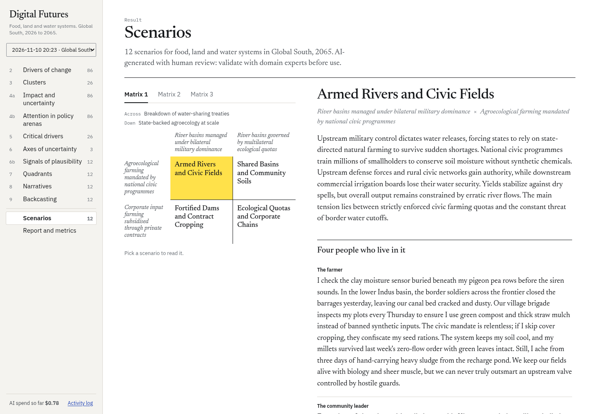

# Digital Futures

An agent that helps a small team build future scenarios for food, land and water systems,
one step at a time, with a person reviewing every step.

It follows the scenario method used in the CGIAR future scenarios workshop held in Palmira in
September 2025: scan for drivers of change, cluster and score them, pick the critical
uncertainties, cross two of them into a 2×2 matrix, and write what each quadrant would be like
to live in. The AI does the reading, searching and drafting. People keep the decisions.

This is a probe of the CGIAR Digital Transformation Accelerator (Area of Work 3, Technology
Horizons), led by the International Potato Center (CIP). It is research software at
proof-of-concept stage, not a product.



## What it does

| Step | What happens | Who decides |
| --- | --- | --- |
| 1 · Scope | Theme, geography, time frame, optional seed drivers | Person |
| 2 · Drivers of change | Web and literature search for about 80 drivers, each with sources | AI proposes, person reviews |
| 3 · Clusters | Drivers grouped by how they interact; graded against a rubric so clusters stay specific | AI proposes, person reviews |
| 4a · Impact and uncertainty | Scores from 1 to 5 with the evidence behind them | AI pre-scores, person adjusts |
| 4b · Attention in policy arenas | One search per driver; the score cites what it found | AI pre-scores, person adjusts |
| 5 · Critical drivers | One per cluster: highest impact and uncertainty, then least discussed | AI proposes, person reviews |
| 6 · Axes of uncertainty | Critical drivers paired into matrices; each axis has two neutral poles | AI proposes, person reviews |
| 6b · Signals of plausibility | For each pole: how far today is from it, with cited signals | AI proposes, person reviews |
| 7 · Quadrants | All four scenarios of every matrix, none prioritised | AI proposes, person reviews |
| 8 · Narratives | Each scenario told by a farmer, a community leader, a scientist and a policy maker | AI proposes, person reviews |
| 9 · Backcasting | A pathway back from the horizon year, and signals for and against it today | AI proposes, person reviews |

At every review the person can approve the step, edit it by hand, or send it back to the AI
with feedback. Results are saved, so going back to a step and continuing without changes costs
nothing. Each run records its time, AI cost and how much the reviewer changed, and exports to
Markdown and JSON.

The design rules come from earlier probes with general chat models (October 2025 to January
2026), which showed what goes wrong when the AI works alone: generic clusters, axes that are
just good against bad, and a pull towards optimistic, technology-driven futures. Those rules
and the full design are in [docs/PLAN.md](docs/PLAN.md).

## Running it

You need Python 3.12 or later, [uv](https://docs.astral.sh/uv/), Docker, Node 20 or later, and
API keys for [OpenRouter](https://openrouter.ai) and [Tavily](https://tavily.com). The paper
search uses the [Asta](https://asta.allen.ai) command line tool.

```bash
cp .env.example .env          # add your API keys
docker compose up -d          # Postgres: checkpoints and memory
uv sync
(cd frontend && npm install && npm run build)
uv run digital-futures-web    # web app at http://localhost:8510
```

`uv run digital-futures` runs the same process in the terminal, and `uv run pytest` runs the
tests.

## What to expect

The first complete run with the default models produced 86 drivers, 26 clusters and 12
scenarios. Steps 6 to 9 of that run took under five minutes of AI time and cost USD 0.17.

Treat the output as material for a conversation, not as a forecast:

- The narratives are fiction that makes a scenario concrete.
- Sources are cited from search results, but the AI can still misread them. Check the ones you rely on.
- The process has not yet been compared with a human-only workshop under controlled conditions.
- Scenarios should be validated with domain experts before anyone uses them for a decision.

## Stack

LangGraph for the step graph and the human review interrupts, deepagents for the two steps
graded against a rubric, Postgres for persistence, FastAPI and React for the web app. Models
are reached through OpenRouter and can be changed in `.env`.

## Credits

Developed by Piero Palacios (CIP). The scenario method and the lessons that shaped the design
rules come from joint work with Marieke Veeger (strategic foresight), Daniel Jiménez (Alliance
of Bioversity International and CIAT) and Leroy Mwanzia (CIP).

Funded by the CGIAR Digital Transformation Accelerator.

Parts of the code and documentation were written with AI assistance and reviewed by the author.

## License

[Creative Commons Attribution 4.0 International](LICENSE).
