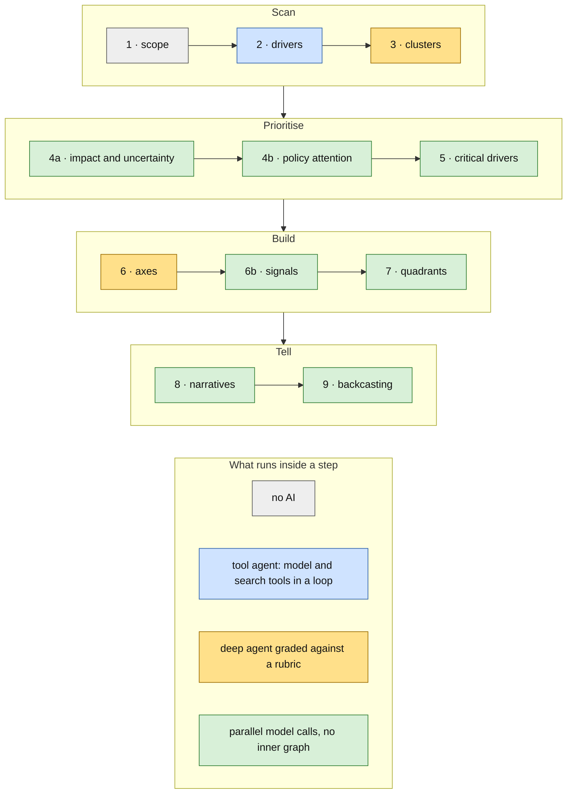
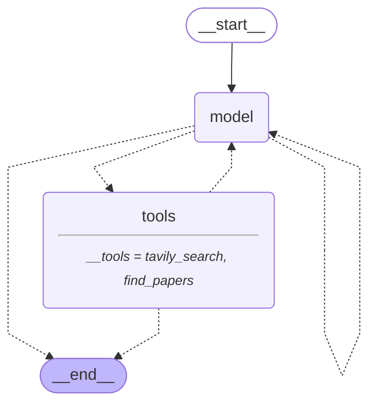
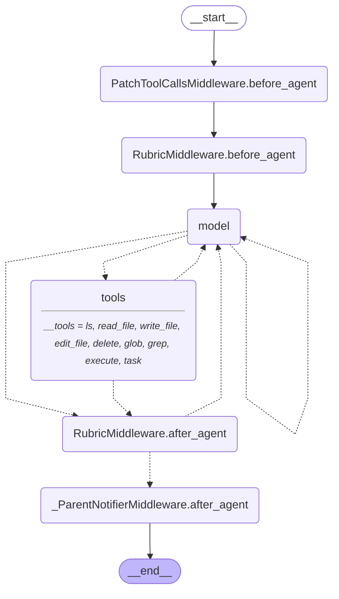

# The graphs

Digital Futures has one scenario graph, compiled once and used for every run. Some of its steps
build a second, smaller graph of their own each time they run: an agent. Most steps do not.

The drawings on this page, except the first, are what LangGraph draws from the compiled
graphs (`get_graph().draw_mermaid()`). To draw them again after a change:

```bash
uv run python scripts/draw_graphs.py docs/graphs
```

## Overview

The eleven steps in order, coloured by what runs inside each one. A person reviews the result
of every step after the scope. This drawing is written by hand; the ones below are generated.



| Step | What runs inside | Its own graph |
| --- | --- | --- |
| 1 · scope | No AI: defaults or the form | None |
| 2 · drivers | A tool agent: the model calls web and paper search until it has enough | Simple: model and tools in a loop |
| 3 · clusters | A deep agent whose answer a grader checks against a rubric, up to three times | Complex: model, tools and the grader's checks |
| 4a · impact and uncertainty | One model call per cluster, in parallel | None |
| 4b · policy attention | One web search per driver in code, then one model call per cluster | None |
| 5 · critical drivers | One model call | None |
| 6 · axes | A deep agent graded against a rubric, as in step 3 | Complex: same shape as step 3 |
| 6b · signals | Searches per pole and per axis in code, then one model call per axis | None |
| 7 · quadrants | One model call per matrix | None |
| 8 · narratives | One model call per scenario | None |
| 9 · backcasting | Two model calls per scenario, with searches in code between them | None |

## The scenario graph

Every step is followed by a review node. The review pauses the run and waits for a person, who
approves the result, edits it, or sends it back with feedback. The dotted arrows are that
choice: back to the same step, or on to the next. With review switched off (`hitl=False`) the
review nodes approve on their own and the graph runs straight through.

```mermaid
---
config:
  flowchart:
    curve: linear
---
graph TD;
	__start__([<p>__start__</p>]):::first
	scope(scope)
	drivers(drivers)
	review_drivers(review_drivers)
	clusters(clusters)
	review_clusters(review_clusters)
	score_impact(score_impact)
	review_score_impact(review_score_impact)
	score_policy(score_policy)
	review_score_policy(review_score_policy)
	critical(critical)
	review_critical(review_critical)
	axes(axes)
	review_axes(review_axes)
	signals(signals)
	review_signals(review_signals)
	quadrants(quadrants)
	review_quadrants(review_quadrants)
	narratives(narratives)
	review_narratives(review_narratives)
	backcast(backcast)
	review_backcast(review_backcast)
	__end__([<p>__end__</p>]):::last
	__start__ --> scope;
	axes --> review_axes;
	backcast --> review_backcast;
	clusters --> review_clusters;
	critical --> review_critical;
	drivers --> review_drivers;
	narratives --> review_narratives;
	quadrants --> review_quadrants;
	review_axes -.-> axes;
	review_axes -.-> signals;
	review_backcast -.-> __end__;
	review_backcast -.-> backcast;
	review_clusters -.-> clusters;
	review_clusters -.-> score_impact;
	review_critical -.-> axes;
	review_critical -.-> critical;
	review_drivers -.-> clusters;
	review_drivers -.-> drivers;
	review_narratives -.-> backcast;
	review_narratives -.-> narratives;
	review_quadrants -.-> narratives;
	review_quadrants -.-> quadrants;
	review_score_impact -.-> score_impact;
	review_score_impact -.-> score_policy;
	review_score_policy -.-> critical;
	review_score_policy -.-> score_policy;
	review_signals -.-> quadrants;
	review_signals -.-> signals;
	scope --> drivers;
	score_impact --> review_score_impact;
	score_policy --> review_score_policy;
	signals --> review_signals;
	classDef default fill:#f2f0ff,line-height:1.2
	classDef first fill-opacity:0
	classDef last fill:#bfb6fc
```



## Inside step 2: the tool agent

The model decides which searches to run, reads the results and searches again until it can
answer. Its tools are Tavily web search and Asta paper search.



## Inside steps 3 and 6: the deep agent with a grader

Steps 3 and 6 build the same graph with different prompts and rubrics. After the model
answers, `RubricMiddleware.after_agent` has a second model grade the answer against the
rubric. If a criterion fails, the answer goes back to the model with the gaps named; after
three checks the last answer is kept.

The tools listed in the drawing (files, shell, sub-agents) are the ones every deep agent
carries by default. The prompts of both steps tell the agent to answer directly and not use
them.



## Why the inner graphs do not appear in the scenario graph

The agents are created and run inside the step's function. They are not registered as
subgraphs of the scenario graph, so LangGraph draws each step as a single node, and review,
saved results and the run record all work at the level of the step.
